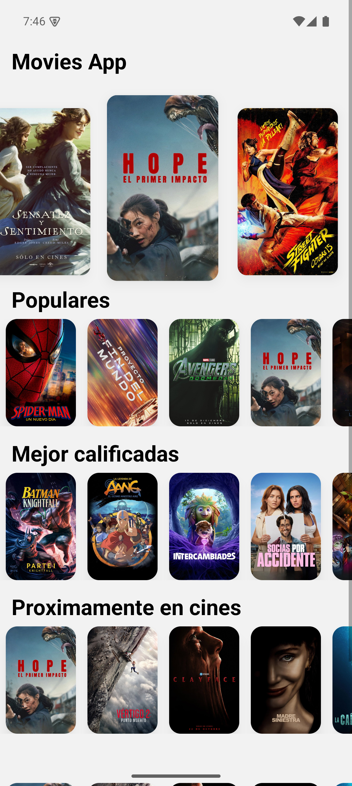
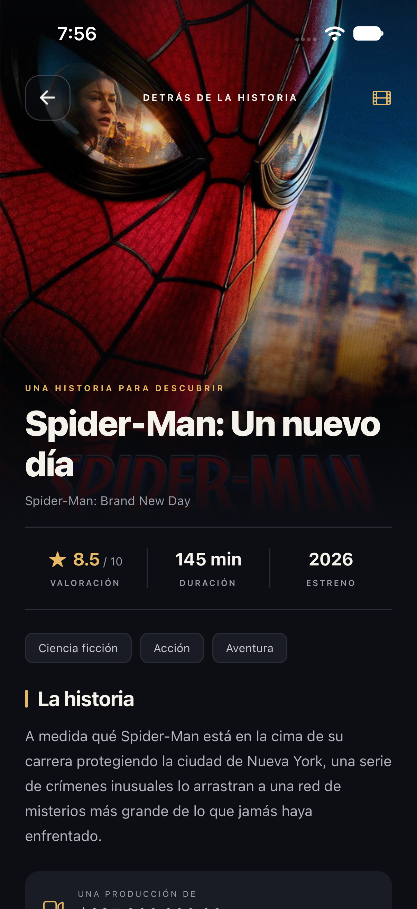

<div align="center">

# 🎬 Movies App

Explora los estrenos, descubre películas populares y conoce a su reparto.
Una aplicación móvil creada con React Native, Expo y datos de TMDB.


</div>

## 📱 La aplicación

Consulta películas en cartelera, revisa selecciones populares y mejor calificadas, y abre cada título para ver su descripción y reparto.

### Capturas de la app


| Inicio | Detalle de película |
| --- | --- |
|  |  |

## ✨ Funcionalidades

- 🎞️ Carrusel de películas actualmente en cartelera.
- 🔥 Sección de películas populares.
- ⭐ Listado paginado de películas mejor calificadas.
- 📅 Próximos estrenos.
- 🎭 Detalle de cada película con descripción, calificación y reparto.
- 📱 Interfaz para Android, iOS y web.

## 🧰 Tecnologías

| Tecnología | Uso |
| --- | --- |
| [React Native](https://reactnative.dev/) | Interfaz móvil multiplataforma |
| [Expo SDK 54](https://docs.expo.dev/versions/v54.0.0/) y [Expo Router](https://docs.expo.dev/versions/v54.0.0/sdk/router/) | Herramientas y navegación por archivos |
| [TypeScript](https://www.typescriptlang.org/) | Tipado del proyecto |
| [NativeWind](https://www.nativewind.dev/) | Estilos con clases de utilidad |
| [Axios](https://axios-http.com/) | Solicitudes a la API |
| [TMDB](https://developer.themoviedb.org/docs) | Catálogo de películas y reparto |

## 🚀 Instalación

### Requisitos

- [Node.js](https://nodejs.org/) (versión LTS) y npm.
- [Expo Go](https://expo.dev/go) en un teléfono o un emulador.
- Una clave de API de [TMDB](https://www.themoviedb.org/settings/api).

### Pasos

1. Clona el repositorio y entra en la carpeta:

   ```bash
   git clone https://github.com/albinrk10/MoviesAppExpo.git
   cd MoviesAppExpo
   ```

2. Instala las dependencias:

   ```bash
   npm install
   ```

3. Copia `.env.template` como `.env` y agrega tu clave de TMDB. La plantilla ya contiene la URL base necesaria:

   ```env
   EXPO_PUBLIC_MOVIE_DB_URL=https://api.themoviedb.org/3/movie
   EXPO_PUBLIC_MOVIE_DB_KEY=tu_clave_de_tmdb
   ```

4. Inicia Expo:

   ```bash
   npx expo start
   ```

Escanea el código QR con Expo Go. También puedes presionar `a` para Android, `i` para iOS o `w` para abrir la app web.

## 📁 Estructura del proyecto

```text
app/                 Pantallas y rutas de Expo Router
  home/              Catálogo principal
  movie/             Detalle de película
core/                API y acciones de datos
infrastructure/      Interfaces y mapeadores de TMDB
presentation/        Componentes y hooks de interfaz
assets/              Iconos e imágenes
```

## 🔐 Clave de TMDB

La clave se configura en `.env`, que está excluido de Git. No publiques ese archivo ni incluyas tu clave en capturas o commits. Usa `.env.template` como referencia para la configuración.

## 📜 Comandos

| Comando | Descripción |
| --- | --- |
| `npm start` | Inicia el servidor de desarrollo de Expo |
| `npm run android` | Inicia Expo para Android |
| `npm run ios` | Inicia Expo para iOS |
| `npm run web` | Inicia la versión web |
| `npm run lint` | Revisa el código con ESLint |

## 👨‍💻 Autor

Creado por [@albinrk10](https://github.com/albinrk10).
